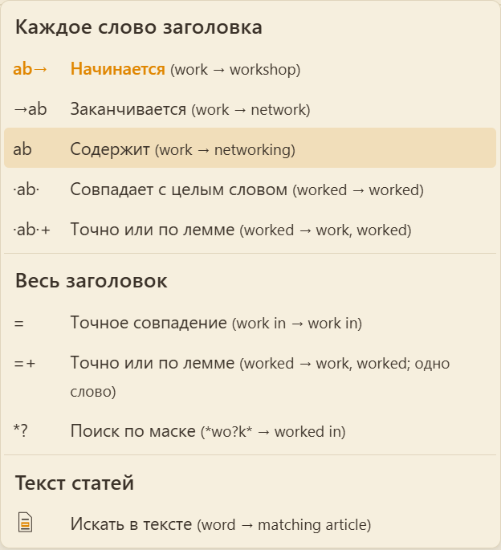

## 🖱️ Меню поиска

### Поиск по словам в заголовке

Эти режимы проверяют каждое слово заголовка отдельно. Например, в заголовке *work in progress* поиск может совпасть со словом *work*, *in* или *progress*.

| Символ | Что делает | Ищем | Что найдётся |
|---|---|---|---|
| `ab→` | Слово начинается с искомого | `work` | *work, worked, workshop* |
| `→ab` | Слово заканчивается искомым | `work` | *work, network, homework* |
| `ab` | Слово содержит искомое в любом месте | `work` | *work, network, homework, working* |
| `·ab·` | Слово точно совпадает | `worked` | только *worked* |
| `·ab·+` | Слово точно совпадает или совпадает его начальная форма | `worked` | *worked* и *work* |

### Поиск по всему заголовку

Эти режимы проверяют **весь заголовок статьи целиком**, а не отдельные слова в нём.

| Символ | Что делает | Ищем | Что найдётся |
|---|---|---|---|
| `=` | Заголовок точно совпадает | `work in` | только заголовок *work in* |
| `=+` | Заголовок точно совпадает или совпадает по начальной форме | `worked` | *worked* и *work* (заголовок должен быть из одного слова) |
| `*?` | Поиск по маске: `*` — любая последовательность символов, `?` — ровно один символ | `*wo?k*` | *work, works, network, homework* |

### Поиск в тексте статей

Этот режим ищет запрос в тексте статей, а не только в заголовках. Если запрос состоит из нескольких слов, сначала ищется фраза: все слова подряд и в заданном порядке. Если фраза не найдена, ищутся все слова запроса в любом порядке, с расстоянием до 10 слов между ними. Если совпадений всё ещё нет, каждое слово запроса может находиться в любом месте статьи. Поиск переходит к следующему варианту, только если предыдущий не дал результатов.

| Символ | Что делает | Пример | Что найдётся |
|---|---|---|---|
|  | Ищет статьи, в тексте которых встречается запрос | `work` | статьи с `work` в тексте |

Для поиска нужен полнотекстовый индекс словаря. Чтобы создать его для всех словарей, откройте <kbd>☰</kbd> → <kbd>Настройки словарей</kbd>, выберите в поле <kbd>по тексту</kbd> значение<kbd>Создать недостающие</kbd> и запустите индексацию. Для конкретного словаря откройте <kbd>☰</kbd> → <kbd>Настройки словарей</kbd>, включите <kbd>по тексту</kbd> для нужного словаря.
### 💡 Полезно знать

- **Начальная форма (лемма)** — это словарная форма слова: для *worked* это *work*, для *mice* — *mouse*. Режимы с `+` учитывают её, чтобы вы находили слово, даже если в заголовке оно стоит в другой форме.
- Режимы `·ab·` и `·ab·+` ищут **слово целиком**, поэтому `·work·` не найдёт *worked* или *workshop*.
- Режимы `=` и `=+` ищут **весь заголовок целиком**, поэтому `=work` не найдёт заголовок *work in progress*.
